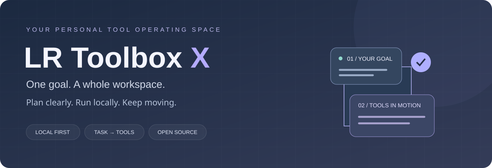

<p align="center"></p>

<p align="center"><a href="README.md">简体中文</a> · <strong>English</strong></p>

<p align="center"><strong>You have the tools. Give them a shared workspace.</strong><br/>Local-first utilities, file workspaces, data analysis, and optional AI task planning.</p>

<p align="center">


</p>

<p align="center"><a href="https://lr-toolbox-x.windy-lotus-5904.chatgpt.site"><strong>Open the workspace ↗</strong></a> · <a href="#get-started">Get started</a> · <a href="#honest-status">Project status</a> · <a href="https://github.com/LLR6/LR-Toolbox-X/issues">Feedback</a></p>

---

## One goal. A whole workspace.

Cleaning a list should not require three websites. Analyzing a CSV should not begin with hunting for import, filter, aggregate, and export buttons.

**LR Toolbox X brings small tasks into a visible path from input to result.** Open a utility directly, or describe a goal and let the task assistant arrange supported tools. Inspect every step, keep completed results when a step fails, and export what you need.

> **Describe → Plan → Run → Inspect → Export**

## See the workspace


_This GIF cycles through actual verification screenshots: task planning, processing an uploaded text file, and DuckDB aggregation. It is a scene carousel, not a continuous recording. The current screenshots show the Chinese app interface; this page provides the complete English project introduction._

## More than a wall of buttons

| Capability                   | What it offers                                                                                         |
| ---------------------------- | ------------------------------------------------------------------------------------------------------ |
| Goal-first task desk         | Inspectable plans, step-by-step execution, run-all, and visible intermediate results                   |
| Dedicated file workspaces    | Full-page PDF, image, OCR, document, media, and data interfaces                                        |
| Optional local AI            | Ollama connection path plus configurable compatible HTTPS model endpoints                              |
| Clear integration boundaries | Browser tools, local services, desktop companions, and external recommendations are labeled separately |

## What can you do today?

| Task                             | Workflow                                                         | Result                                        |
| -------------------------------- | ---------------------------------------------------------------- | --------------------------------------------- |
| Clean a repeated list            | Import text → remove blank lines → deduplicate → sort            | Downloadable clean text                       |
| Fix broken JSON                  | Repair → format                                                  | Readable JSON                                 |
| Turn an HTML fragment into notes | Convert to Markdown → trim                                       | Markdown text                                 |
| Explore CSV data                 | Import → query with DuckDB SQL → aggregate                       | Table preview and JSON export                 |
| Process documents and images     | Open the relevant dedicated workspace                            | Tool-specific file results                    |
| Prepare local tools              | Create isolated environments → install → inspect status and logs | Local dependencies ready for further adapters |

The local deployment work is in progress. Installed packages are not automatically equivalent to verified business operations or Agent integration.

## Capability map

**Text and development:** JSON, CSV, YAML, XML, Markdown, text differences, code formatting, encoding, hashes, QR codes, archives, dates, and unit conversion.

**Documents and creation:** PDF organization, image compression and cropping, OCR, DOCX extraction, media processing, Mermaid, spreadsheets, SVG, photo metadata, and additional workspaces.

**Data and research:** Browser SQL analysis with DuckDB; project discovery for portfolio tracking, stock and fund data, and crypto backtesting. Financial recommendations, installed dependencies, and actual execution adapters have separate statuses. The app does not provide automated trading.

**Local deployment:** Isolated Python installation, status checks, and logs for AKShare, MarkItDown, and Docling. Adapters have been written for MarkItDown text-file conversion and AKShare fund net-value history. Third-party end-to-end execution remains unverified.

## What does AI do here?

AI selects supported built-in tools for a goal. Plans are checked against allowed tool IDs and a step limit before execution.

- **No model required for templates:** list cleanup, JSON repair, and HTML-to-Markdown examples work locally.
- **Local model option:** the package provides a loopback service and Ollama connection path, with Qwen3 1.7B as the default model.
- **Compatible API option:** configure a complete HTTPS Chat Completions endpoint, model name, and key. Browser CORS support is required.
- **Planning and file contents are separate:** planning sends the task description and allowed catalog, not the uploaded file body. Anything included in the description is sent to the chosen provider.

The task assistant currently chains safe tools with a single text input, up to eight steps. It does not execute arbitrary model-generated shell commands. File-workspace orchestration and complete third-party tool integration remain under development.

## Get started

### Try the hosted workspace

Open [LR Toolbox X](https://lr-toolbox-x.windy-lotus-5904.chatgpt.site), select the task assistant, choose an example, generate a plan, and run it. The hosted site retains its owner's access configuration and may require authorization. Public source code is available for self-hosting.

### Run from source

Requirements: Node.js 24 LTS and npm.

```sh
git clone https://github.com/LLR6/LR-Toolbox-X.git
cd LR-Toolbox-X
npm ci
npm run dev
```

Build and check:

```sh
npm run typecheck
npm test
npm run build
```

### Build the local package

```sh
npm run build
python3 scripts/package-local-agent.py
```

Output: `dist/downloads/lr-local-agent.zip`.

The package contains the core web interface and local Python service. Large OCR/media engines and model weights are excluded. Installation requires network access and may require system prompts or manual dependency setup.

On Windows, the launcher attempts to install Ollama and Python through winget when missing. On macOS/Linux, prepare Python 3.10+ and follow the launcher instructions. The Python service can start without Ollama; prepare Ollama and the model separately for AI planning. Installation has not been verified across all target devices.

## Built for real tasks, open to better ideas

The visual language combines alpine dusk, soft slate-blue and warm-gray themes, consistent icons, and full-page workspaces. The aim is a clear starting point and a result whose origin you can inspect.

**Less searching. More finishing.**

Useful contributions begin with a real task, a shareable test input, or a reproducible bug. Do not post API keys or private documents in public issues.

[Report a bug](https://github.com/LLR6/LR-Toolbox-X/issues) · [Suggest a tool](https://github.com/LLR6/LR-Toolbox-X/issues) · [Roadmap](ROADMAP.md)

## Honest status

| Area                   | Current state                                                                                                                 |
| ---------------------- | ----------------------------------------------------------------------------------------------------------------------------- |
| Portable utilities     | 134 Action IDs; six additional native Rust actions                                                                            |
| Specialized workspaces | 25 entries, including desktop companion entries; not all run inside the browser                                               |
| Android                | A smaller native subset, not feature parity with the web app                                                                  |
| Deployment center      | Initial Python installation and execution adapters; end-to-end platform validation incomplete                                 |
| Validation             | 401 portable utility unit tests completed in the recent cycle; four basic local-adapter tests. Check Actions for current runs |
| Long-term ambition     | 2,000+ real tools — **not reached yet**                                                                                       |

Current local execution adapters accept text-like files up to 2 MB for MarkItDown and six-digit fund codes for AKShare historical net values, returning up to 2,000 rows. These adapters require locally installed dependencies and have not yet passed third-party end-to-end verification. Office/PDF conversion, stock queries, Docling operations, and automatic Agent invocation are still pending.

The detailed [user guide](docs/USER-GUIDE.md) and [integration checklist](docs/LOCAL-INTEGRATIONS.md) currently contain Chinese documentation. This English README is a complete standalone introduction; language switching does not change the app's current feature coverage.

## Open source and credits

Project code is licensed under [Apache-2.0](LICENSE). Third-party programs, model weights, data sources, and assets retain their own licenses and terms. Thank you to the maintainers of every integrated and recommended project.

<p align="center"><sub>Built by LR · Local first. Clear steps. Real tools.</sub></p>
