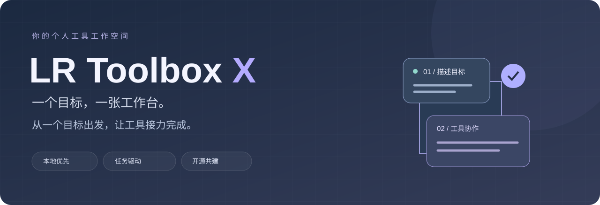
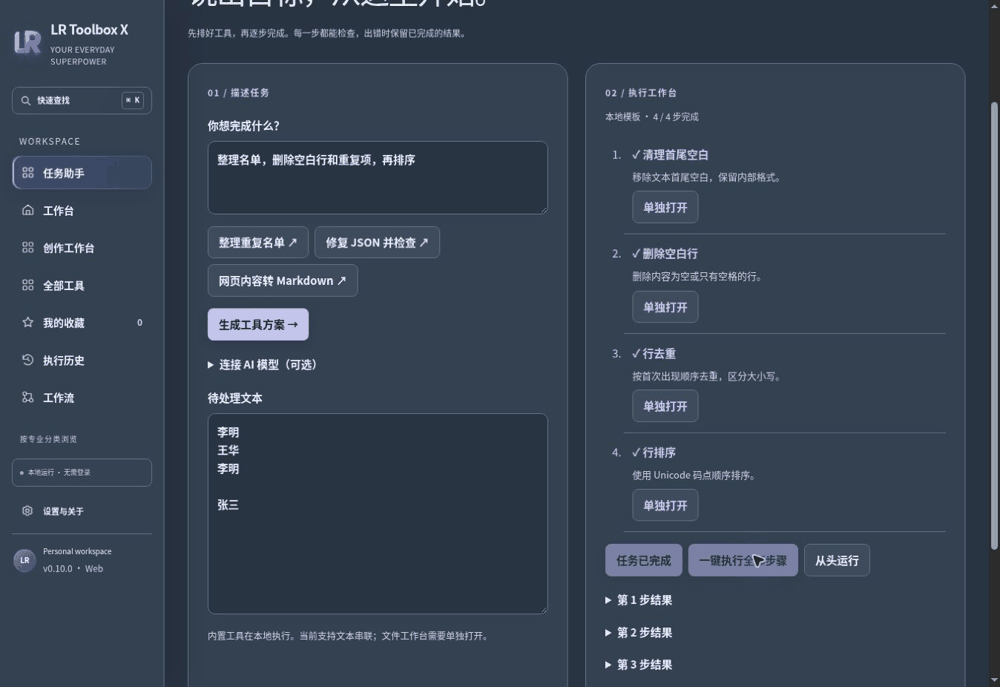

<p align="center"></p>

<p align="center"><strong>简体中文</strong> · <a href="README.en.md">English</a></p>

<p align="center">
  <strong>你的工具很多。现在，让它们一起工作。</strong><br/>
  本地优先的个人工具工作空间 · 文件处理 · 数据分析 · AI 任务编排
</p>

<p align="center">
  
  
  
  
</p>

<p align="center">
  <a href="https://lr-toolbox-x.windy-lotus-5904.chatgpt.site"><strong>打开工作空间 ↗</strong></a> ·
  <a href="#五分钟上手">快速开始</a> ·
  <a href="docs/USER-GUIDE.md">完整指南</a> ·
  <a href="docs/LOCAL-INTEGRATIONS.md">真实接入进度</a> ·
  <a href="https://github.com/LLR6/LR-Toolbox-X/issues">反馈与想法</a>
</p>

---

## 一个目标，一张工作台

你想整理一份名单，却先后打开了去空行、去重、排序三个网站。

你想分析一份 CSV，却还在寻找导入、筛选、汇总和导出分别藏在哪里。

**LR Toolbox X 想把这些来回切换，变成一条看得见的任务路径。**

在这里，你可以直接使用工具，也可以描述目标，让任务助手排出步骤。输入、过程、结果都留在工作台上：知道下一步是什么，也知道结果从哪里来。

> **从描述到结果，每一步都看得见**
> 说出目标 → 排好工具 → 执行步骤 → 检查结果 → 带走成果

## 看看工作台



_动图轮播三张实际验证截图：任务编排、上传文件后处理、DuckDB 汇总结果。它展示不同场景，并非一段连续操作录像。_

## 不止一排工具按钮

<table>
<tr>
<td width="50%" valign="top">

### ✦ 从目标开始

“清理这份名单，再按行排序。”

任务助手生成可检查的工具方案，支持逐步执行或一键运行全部步骤。失败时保留已完成的结果，方便定位问题。

</td>
<td width="50%" valign="top">

### ◈ 文件有自己的工作台

PDF、图片、OCR、Word、音视频和数据处理拥有独立全页空间。文本类文件也能直接导入任务助手，继续处理并下载结果。

</td>
</tr>
<tr>
<td valign="top">

### ⌘ 模型可以在自己电脑上

可选 Ollama 本地模型，也可配置兼容模型接口。模型负责规划，内置工具负责执行；没有连接模型时，明确使用本地模板。

</td>
<td valign="top">

### ↗ 过程可见，能力有据

每一步都有工具名称、输入和输出。浏览器执行、本地服务、桌面配套和外部推荐明确区分，不靠外链或上游数量凑工具总数。

</td>
</tr>
</table>

## 今天可以用它完成什么？

| 你的任务               | 工作路径                             | 得到什么                 |
| ---------------------- | ------------------------------------ | ------------------------ |
| 整理重复名单           | 导入文本 → 去空行 → 去重 → 排序      | 可下载的干净名单         |
| 修复损坏 JSON          | 原始内容 → JSON 修复 → 格式化        | 可读、可继续使用的 JSON  |
| 把网页片段变成笔记     | HTML → Markdown → 清理               | Markdown 文本            |
| 看懂 CSV 数据          | 导入 CSV → DuckDB SQL 分组与筛选     | 结果表格、JSON 导出      |
| 整理文档与图片         | PDF / OCR / 图片等独立工作台         | 对应文件处理结果         |
| 准备本地文档与数据工具 | 部署中心 → 安装隔离环境 → 检测与日志 | 可继续适配的本地工具环境 |

最后一项属于正在推进的本地集成：安装成功不等于所有业务功能已验证，也不等于已经接入 Agent。

## 能力地图

**文字与开发**
JSON、CSV、YAML、XML、Markdown、文本差异、代码格式化、编码解码、哈希校验、二维码、压缩归档、时间与单位换算。

**文档与创作**
PDF 整理、图片压缩与裁剪、文字识别、DOCX 提取、音视频处理、Mermaid、Excel、SVG、照片信息及更多特色工作台。

**数据与研究**
DuckDB 浏览器 SQL 分析；股票、基金和加密资产工具发现，包括 Ghostfolio、AKShare、Freqtrade。金融项目的推荐、安装适配和实际执行状态分别标注；当前不提供自动交易。

**本地部署**
AKShare、MarkItDown、Docling 的隔离 Python 环境安装、状态检测和日志查看。已编写 MarkItDown 文本类转换及 AKShare 基金净值历史执行适配，第三方端到端实测仍待完成。

## AI 在这里做什么？

它把你的目标翻译成一组内置工具步骤。工具目录和步骤数量经过校验，执行过程中展示结果，便于你继续处理。

- **没接模型也能用**：提供名单整理、JSON 修复、HTML 转 Markdown 模板。
- **可以接本地模型**：本地包提供回环服务与 Ollama 连接路径，默认模型为 Qwen3 1.7B。
- **可以接兼容接口**：配置 HTTPS Chat Completions 接口、模型名与密钥。
- **文件与规划分开**：目前生成方案发送任务描述和允许目录，不发送上传文件正文；请留意自己在任务描述中填写的内容。

当前 Agent 主要串联单一文本输入工具，最多 8 步。它不是任意电脑操作代理，不会执行模型自由生成的 shell 命令。文件工作台与所有第三方软件的自动串联仍在开发中。

## 五分钟上手

### 直接体验

打开 [LR Toolbox X](https://lr-toolbox-x.windy-lotus-5904.chatgpt.site)，进入“任务助手”，选择一个示例，再生成方案并执行。托管站点当前保留所有者访问配置，可能需要授权；公开源码可自行运行。

### 从源码运行

需要 Node.js 24 LTS 与 npm：

```sh
git clone https://github.com/LLR6/LR-Toolbox-X.git
cd LR-Toolbox-X
npm ci
npm run dev
```

构建与检查：

```sh
npm run typecheck
npm test
npm run build
```

### 本地部署包

网站“本地部署”页面提供 ZIP 下载。解压后使用 Windows 启动器，或按 [本地指南](local-agent/README.md)启动 Python 服务。

从源码制作：

```sh
npm run build
python3 scripts/package-local-agent.py
```

生成 `dist/downloads/lr-local-agent.zip`。包内包含网页核心与本地服务，大型 OCR/媒体引擎及模型权重不随包捆绑。第三方安装需要网络，系统确认和缺失依赖可能仍需手动处理。

## 为自己打造，也欢迎一起打磨

LR Toolbox X 的视觉来自雪山暮色与桌面工作空间：柔和的雾蓝灰、暖灰白、统一图标和全页工具操作区。目标是让复杂任务有清楚的起点，让每个结果有可追溯的过程。

**少一点寻找，多一点完成。**

如果你想贡献，最有价值的起点是：带来一个真实任务、一份可公开的测试输入，或者一个清晰的错误复现。

[提交 Bug](https://github.com/LLR6/LR-Toolbox-X/issues) · [提出工具建议](https://github.com/LLR6/LR-Toolbox-X/issues) · [查看路线图](ROADMAP.md)

## 透明进度

| 项目         | 当前状态                                                                             |
| ------------ | ------------------------------------------------------------------------------------ |
| 便携工具     | 134 个 Action；原生 Rust 另有 6 个动作                                               |
| 特色工作台   | 25 个入口，包含独立桌面配套入口，并非全部在网页内运行                                |
| Android      | 较小的原生工具子集，不等同于完整 Web 功能                                            |
| 本地部署中心 | 第一批 Python 安装适配与执行接口已编写，跨平台端到端验证未完成                       |
| 验证         | 最近已完成 401 项便携工具单元测试；本地适配另有 4 项基础测试。最新结果请查看 Actions |
| 长期目标     | 2000+ 个真实工具，**尚未达到**                                                       |

完整细节请阅读 [使用指南](docs/USER-GUIDE.md)、[逐项集成状态](docs/LOCAL-INTEGRATIONS.md)与 [工具目录](docs/actions.md)。

## 开源与致谢

项目自身代码采用 [Apache-2.0](LICENSE)。第三方程序、模型、数据源与图标等资产遵守各自许可证和条款；本项目许可证不覆盖它们。感谢所有被集成或推荐项目的维护者。

<p align="center"><sub>由 LR 打造 · 本地优先 · 步骤清晰 · 工具真实</sub></p>


[全部工具逐项说明](docs/TOOLS.md) · [安装包发布说明](docs/RELEASE-PREVIEW.md)
